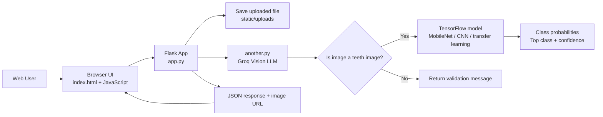

# DentalVision AI – System Architecture

## 1. High-level architecture

The system is a simple three-layer application:

1. Frontend layer
   - A browser-based upload form rendered by Flask
   - JavaScript handles request submission and result display

2. Backend layer
   - Flask app serves the UI and prediction API
   - File saving and preprocessing happen here
   - It orchestrates validation and inference

3. ML layer
   - A TensorFlow model performs disease classification
   - A Groq-hosted multimodal LLM performs “is this a teeth image?” validation

## 2. Runtime architecture

## 3. Component responsibilities

### Frontend

The UI is a single page generated from `templates/index.html`.

Responsibilities:

- Render a file input control
- Submit image using `POST /predict`
- Handle JSON response
- Show prediction and uploaded image

### Backend

`app.py` responsibilities:

- Serve the home page at `/`
- Receive a file upload at `/predict`
- Check that a file exists
- Save the image to `static/uploads`
- Validate image type using `analyze_image`
- Preprocess image for TensorFlow
- Load model and run prediction
- Shape final response JSON
- Handle exceptions

### ML validation helper

`another.py` responsibilities:

- Encode the image as base64
- Build a multimodal Groq chat request
- Ask: “Is this a teeth image?”
- Parse JSON output with `is_teeth` field
- Return boolean decision to the Flask app

### Training notebook

`Source code.ipynb` is the training environment, not a runtime service.

It contains:

- dataset loading logic
- train/test/validation splitting
- image augmentation
- CNN and transfer learning model builders
- training loop
- evaluation
- model saving

## 4. Data flow

1. User uploads file through browser
2. Flask saves image to the local static folder
3. Groq API checks whether it is a teeth image
4. If valid, the image is being preprocessed
5. TensorFlow model predicts class probability vector
6. Flask chooses argmax class and confidence score
7. JSON response is returned to browser
8. JavaScript surfaces the result on the page

## 5. Architectural concerns and constraints

### Coupling and separation of concerns

The current architecture mixes model-serving logic, validation logic, and file handling in `app.py`. This is simple but not production-grade. A cleaner design would split these into:

- API layer
- service layer
- ML inference service
- validation service
- model registry
- data access/config modules

### Hardcoded config

Key information is embedded directly into code:

- Local model path is hardcoded in `app.py`
- Groq API key is loaded from environment variables
- Upload folder is hardcoded as `static/uploads/`
- Image size is hardcoded to `128x128`
- Labels are hardcoded as a fixed list

### Inference pipeline risk

The app performs a validation call before inference, but the validation layer is external to the model and based on a cloud LLM call. This adds latency and cost and introduces a non-deterministic dependency on a third-party API.

## 6. Architectural summary

The current project architecture is best described as a lightweight academic prototype architecture:

- simple client-server model,
- image upload pipeline,
- external model validation,
- local TensorFlow inference,
- minimal UI for demonstration.

It is useful for learning and prototyping but not yet a robust system architecture suitable for deployment in a real clinical environment or production portfolio-grade application.
